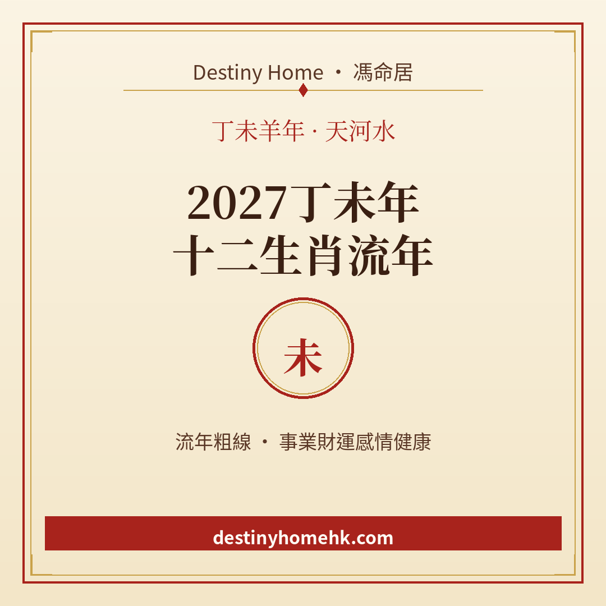

# 2027丁未年｜十二生肖流年運程總覽

Destiny Home／馮命居

<!-- OG 1200×630: covers/cover-總覽-og.png -->

2027 年係 **丁未年**——天干丁火（陰火），地支未土（羊），納音叫「天河水」。火土同見，水氣藏喺納音，整體氣氛似「天河落凡間」：有熱度、有想法，但亦要顧住節奏同情緒，唔好一味衝。

呢系列文章會分開寫十二生肖嘅流年粗線：邊個較易受力、邊個有合局加持、邊個屬平運可以主動發揮。記住——**生肖流年只係粗線**；真正準要睇八字、大運同流年干支嘅配合。

**小提示（全系列通用）**：八字流年由立春起算——2027 丁未年大約由 **2027 年 2 月 4 日約 09:46（香港時間）** 起，至 2028 立春前。民間生肖多數跟農曆正月初一（2027 年 2 月 6 日）。立春前出世嘅朋友，所屬生肖可能同國曆年份唔一樣，有疑問可以再核對。

## 丁未年太歲關係一覽

太歲地支係「未」。同未嘅關係，大致可以咁睇：

| 生肖 | 太歲關係 | 關鍵字 |
|------|----------|--------|
| 羊 | 值太歲（本命年） | 事多、易被睇、要低調守成 |
| 牛 | 沖太歲（丑未沖），兼刑 | 變動大、人際易拗、合約小心 |
| 狗 | 刑太歲（戌未），兼破（輕） | 是非、細節出錯、節奏亂 |
| 鼠 | 害太歲（子未害） | 暗耗、誤會、小人氣場 |
| 馬 | 六合（午未） | 貴人、合夥、節奏順 |
| 兔 | 三合（亥卯未） | 合作、人脈、機會較易湊 |
| 豬 | 三合（亥卯未） | 支援、人緣、項目易開花 |
| 蛇 | 三會（巳午未） | 南方氣勢、事業可加溫 |
| 虎 | 無直接沖合刑害 | 平運，靠主動進取 |
| 龍 | 無直接沖合刑害 | 平運，靠主動進取 |
| 猴 | 無直接沖合刑害 | 平運，靠主動進取 |
| 雞 | 無直接沖合刑害 | 平運，靠主動進取 |

犯太歲唔等於「一定衰」，合局亦唔等於「自動發達」——重點係你點樣配合節奏：該守就守、該動就動、該講清楚就講清楚。

## 點用呢系列文章

1. 先睇自己生肖嗰篇，留意「受力類型」或者「合局關鍵字」。
2. 對照工作、錢銀、感情、健康四個範疇，揀一至兩樣本年最想改善嘅位。
3. 化解建議以實際行動為主（低調、合約、搬遷節奏、人際界線等）；安太歲屬民俗選項，可做可不做，唔硬銷。
4. 若想睇個人八字流年同大運，再考慮詳批。

## 想睇更細？

想睇得更準，記得生肖流年只係粗線，真正細位要對八字同大運。Destiny Home 有【流年詳批 HK$128】同【全批一生大運＋十年大運＋流年 HK$688】，歡迎到 https://destinyhomehk.com 了解，或者 WhatsApp 預約（destiny_home_）。

※ 本文僅供參考，非醫療、投資或法律建議。內容屬流年趨勢分享，亦可能運用 AI／非師傅親批之輔助整理，實際決策請以個人情況同專業意見為準。
