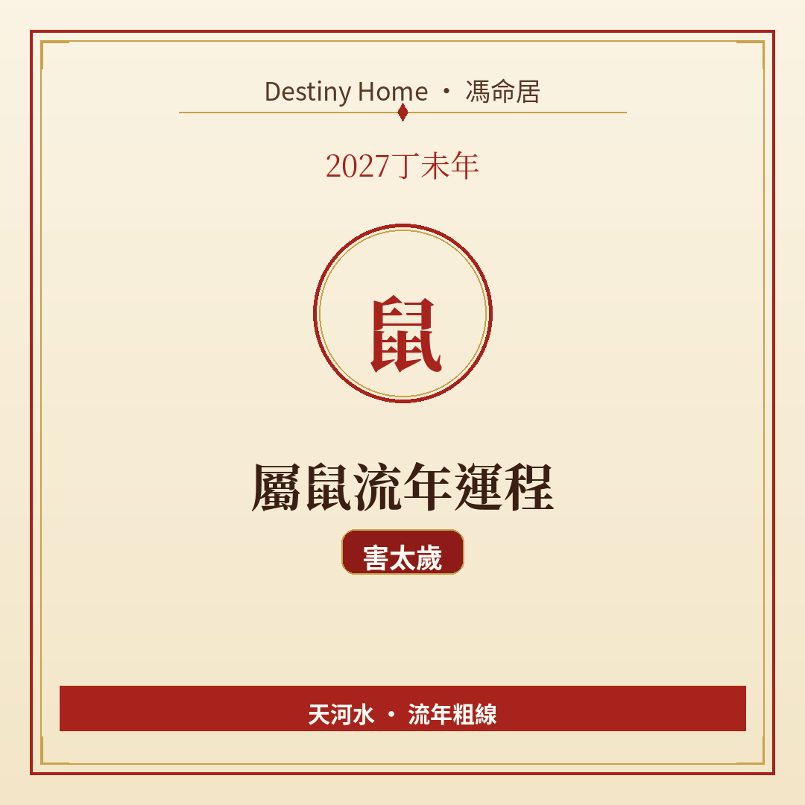

# 2027丁未年｜屬鼠流年運程

Destiny Home／馮命居

屬鼠今年面對 **害太歲（子未害）**——唔係大起大落嘅明刀明槍，而係暗湧、誤會同「講咗當冇講」嘅消耗。關鍵字：**小心誤會、守口如瓶、錢銀要記帳**。

## 出生年份提示

常見屬鼠年份（國曆約數）：1948、1960、1972、1984、1996、2008、2020。  
立春前出世可能屬前肖（豬），民間亦有跟農曆正月初一（2027-02-06）計；八字流年則由立春（2027-02-04 約 09:46 香港時間）起算。

## 整體運勢

害太歲嘅感覺，好多時係「明明冇大錯，但成日有啲唔順」：傾唔掂、資訊有落差、身邊有人口甜但心口不一。丁未年火土旺、納音天河水，屬鼠本身水氣較強，反而要防「水火交戰」——情緒上落、睡眠同消化都可能受影響。

本年宜 **穩陣過橋**：重要決定慢半拍、白紙黑字、少聽八卦。唔使驚到唔敢郁，但每一步都要留證據同退路。

## 事業／工作

職場容易出現溝通誤差——Email 漏睇、同事轉述失真、上司期望同你理解唔同。建議：

- 會議後用文字覆核重點；
- 唔好代人孭飛，界線講清楚；
- 轉工或轉崗可以考慮，但背景調查同合約條款要睇實。

有管理職嘅屬鼠，特別要防「被人借你個名」或者「背地裡有微言」。你哋平時機靈，今年機靈要用喺防守同核實，唔好用喺猜忌同反擊。

## 財運

偏財、賭波、聽消息買嘢，今年風險偏高——害太歲經典係「暗耗」：細數走漏、訂閱忘咗取消、借出去難收。正財（人工、穩陣生意）反而相對穩，只要你唔衝動加槓桿。

實用做法：每月記帳、大額支出等三晚、唔好做人情保證人。投資維持分散同可承受虧損範圍，唔好因為「聽人講好景」就梭哈。

## 感情／人際

單身者容易遇「傾得好投緣但細節對唔上」嘅對象；拍拖或已婚則要防冷戰——往往唔係大事，而係語氣同預期管理。親朋之間亦可能有口角或被拖累，學會溫柔地拒絕。

人際上，少參與是非圈，多維護一兩個真心朋友就夠。社交可以有，但唔好公開過多私人計畫。

## 健康／身心

留意腸胃、睡眠、偏頭痛同情緒波動。壓力來時唔好一味硬撐，散步、早睡、減少咖啡因都有幫助。若本身有慢性病，依時覆診，唔好自行停藥。

## 今年提點／化解

1. **重要承諾白紙黑字**——口頭協議今年特別易出事。  
2. **減少八卦同轉發**——害太歲怕「言多必失」。  
3. **錢銀分戶口、設預算**——防暗耗最實際。  
4. **安太歲屬民俗選項**——想安心可以跟傳統拜太歲／安太歲，但唔取代合約同界線管理。

## 短結

屬鼠 2027 宜守不宜躁，害氣重在誤會同暗耗，處理好人際同帳目，日子仍然可以平穩有進度。

想睇得更準，記得生肖流年只係粗線，真正細位要對八字同大運。Destiny Home 有【流年詳批 HK$128】同【全批一生大運＋十年大運＋流年 HK$688】，歡迎到 https://destinyhomehk.com 了解，或者 WhatsApp 預約（destiny_home_）。

※ 本文僅供參考，非醫療、投資或法律建議。內容屬流年趨勢分享，亦可能運用 AI／非師傅親批之輔助整理，實際決策請以個人情況同專業意見為準。
