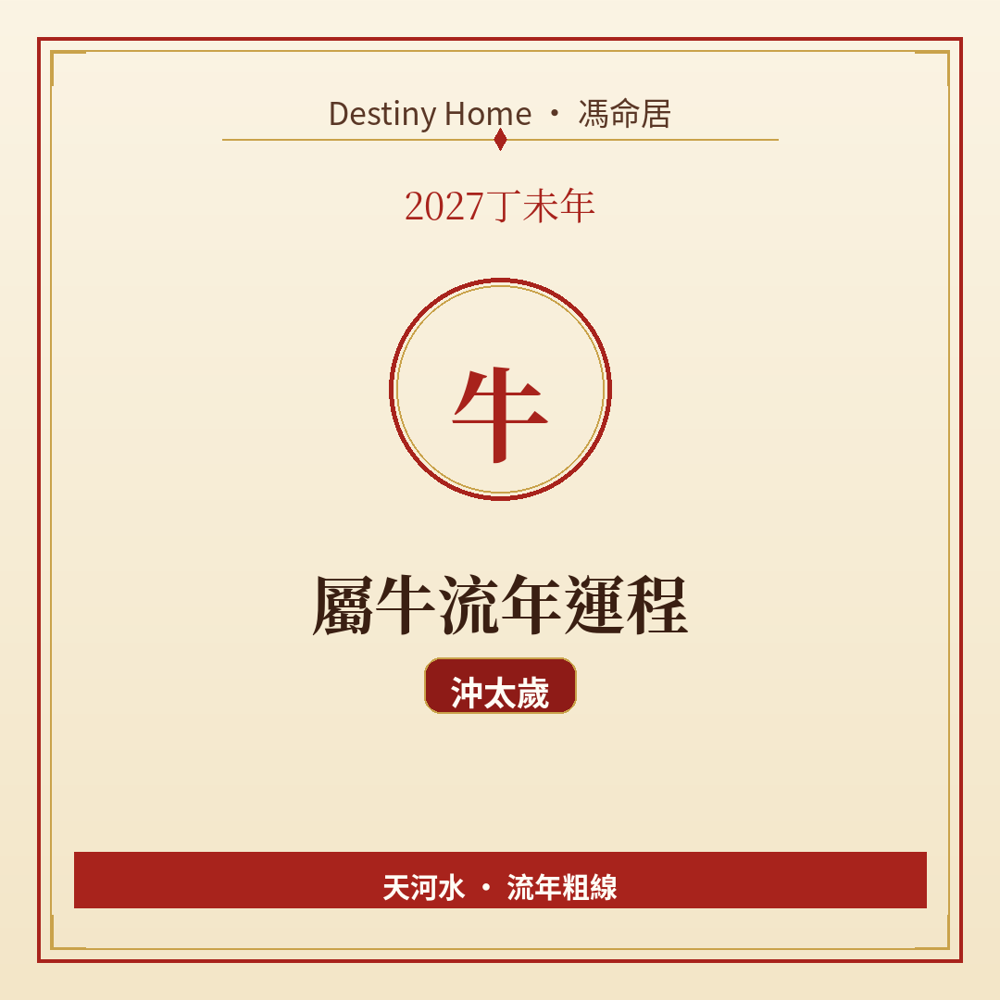

# 2027丁未年｜屬牛流年運程

Destiny Home／馮命居

屬牛今年 **沖太歲（丑未沖）**，兼有刑嘅味道——變動、衝突、節奏被打亂嘅機會明顯高一截。關鍵字：**變動可避則緩、合約要硬、脾氣要收**。

## 出生年份提示

常見屬牛年份（國曆約數）：1949、1961、1973、1985、1997、2009、2021。  
立春前出世可能屬前肖（鼠）；八字由立春起算，民間生肖多跟農曆年。犯太歲年份特別值得核對自己真正生肖同八字。

## 整體運勢

沖太歲唔等於「一定出事」，而係 **靜唔住**：屋企、工作、居住、合作關係其中一兩樣，好可能要面對調整。丑未沖帶刑，爭執可以因為「原則」而升級——你哋固執有好處，但今年固執容易變成內耗。

丁未年火土同見，納音天河水，屬牛土重，壓力感可能加重。策略係：**主動規劃變動，好過被逼倉**。例如你已經想換環境，不如早啲做時間表；如果一切都穩，就唔好為變而變。

## 事業／工作

職位調動、上司更換、項目腰斬重做、合夥意見不合——呢類戲碼相對常見。建議：

- 年頭做好技能同人脈備份，唔好把所有籌碼放同一個平台；
- 開會爭執時，先寫重點再講，避免當面頂撞；
- 離職或轉行可以，但下家要談妥先走，唔好意氣用事。

打工族留意績效評估同書面指示；做生意嘅屬牛，供應鏈同租約條款要重新掃一遍。

## 財運

大額投資、聯名生意、為人擔保，今年風險偏高。沖太歲下，現金流容易「斷一下」——未必係蝕大筆，而係收款慢、突發開支、裝修／搬遷成本。

宜：保留較厚應急儲備、分期大額開支、避免高槓桿。若有物業或租務變動，計清楚稅項同隱藏費用再落筆。

## 感情／人際

親密關係同家人最易因為「語氣硬」而嘈。你覺得自己有道理，對方覺得你唔肯讓——其實兩邊都攰。約會或者家庭聚會，預留冷靜時間；大事唔好喺攰同餓嘅時候傾。

合作關係上，分清楚「朋友」同「生意夥伴」，混喺一齊今年特別易傷感情。

## 健康／身心

脾胃、濕重、關節、血壓同失眠值得留意。搬遷、裝修灰塵、長途奔波都會傷身。運動選溫和持續（行山、游泳、伸展），少做逞強式爆發。

情緒上允許自己慢半拍，唔好用「我頂得順」掩蓋倦意。

## 今年提點／化解

1. **重大決定寫時間表**——沖歲宜有計畫嘅動，忌情緒化嘅動。  
2. **合約、保險、租約全面檢查**——防「以為口頭夠」嘅漏洞。
3. **爭執先冷靜再回覆**——WhatsApp 慢十秒，少十場火滾。  
4. **安太歲可作民俗安心選項**；同時做好搬家／轉工節奏管理更實際。

## 短結

屬牛 2027 變數較多，丑未沖刑要你學會「柔中帶剛」：該守嘅底線守硬，其餘留彈性。過得好嘅關鍵唔係零變動，而係變得有序。

想睇得更準，記得生肖流年只係粗線，真正細位要對八字同大運。Destiny Home 有【流年詳批 HK$128】同【全批一生大運＋十年大運＋流年 HK$688】，歡迎到 https://destinyhomehk.com 了解，或者 WhatsApp 預約（destiny_home_）。

※ 本文僅供參考，非醫療、投資或法律建議。內容屬流年趨勢分享，亦可能運用 AI／非師傅親批之輔助整理，實際決策請以個人情況同專業意見為準。
