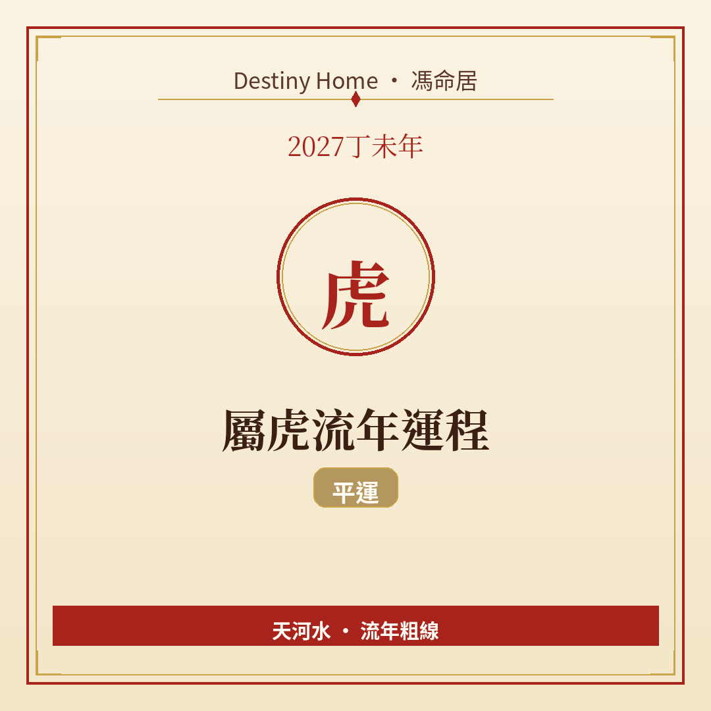

# 2027丁未年｜屬虎流年運程

Destiny Home／馮命居

屬虎今年 **無直接沖合刑害**，屬平運格局——唔會自動送運，亦唔會無端被太歲針對。關鍵字：**主動進取、節奏自己定、火力要用得精**。

## 出生年份提示

常見屬虎年份（國曆約數）：1950、1962、1974、1986、1998、2010、2022。  
立春前出世可能屬前肖（牛）。八字流年由 2027-02-04 約 09:46（香港時間）起算。

## 整體運勢

平運年生肖最易犯兩個極端：一係覺得「冇特別提示」就懶理規劃；二係見到別人犯太歲就過度焦慮。對屬虎嚟講，丁未年火土氣氛其實幾襯你哋嘅行動力——有空間表現，但唔好亂燒能量。

納音天河水提醒：外表熱鬧、內裡要留一條冷靜水道。你衝得快，記得留時間復盤。

## 事業／工作

適合主動提案、爭取可見度高嘅項目、補技能短板。上司同客戶較容易留意到「肯出手」嘅人——前提係你交貨穩陣，唔係淨係聲量大。

平運年生肖最容易「等運到」；屬虎反而適合做嗰個開波嘅人。帶人或者跨部門時，語氣可以剛，但結論要留空間畀人執行。

宜：訂季度目標、每個月檢一次進度、找一位可信任同事做互相監督。轉工唔急嘅話，可以慢慢睇；有更好平台就談條件，唔好裸辭憑感覺。

## 財運

正財穩中帶進，偏財靠運氣成分唔高——與其追熱炒，不如提升議價同副業技能。大額消費可以，但要對齊你全年目標（例如進修、工具升級），唔好報復性購物。

理財上，檢視保險同緊急備用金是否足夠；平運年正係「補基礎」好時機。

## 感情／人際

單身可以主動認識人，但篩選要認真——你魅力足，反而要防吸引到「喜歡刺激但唔穩」嘅對象。有伴者，多安排共同活動，少用工作當逃避傾偈嘅藉口。

職場人際保持專業友善即可，唔使刻意討好，亦唔使擺架子。

## 健康／身心

肝氣、血壓、外傷（因為郁得多）要小心。運動好，但熱身同護具唔好慳。睡眠質素影響你成日嘅脾氣同判斷，盡量固定作息。

## 今年提點／化解

1. **為自己訂三個全年優先事項**——平運靠主動，散焦就浪費。  
2. **每季復盤一次**——邊樣做得好、邊樣要停。  
3. **衝動決定冷卻 48 小時**——尤其金錢同關係。  
4. **身體保養列入行程**——唔好等攰崩先休息。

## 短結

屬虎 2027 係「你出幾多力，就有幾多回饋」嘅年份。太歲唔阻你，關鍵係紀律同方向感。

想睇得更準，記得生肖流年只係粗線，真正細位要對八字同大運。Destiny Home 有【流年詳批 HK$128】同【全批一生大運＋十年大運＋流年 HK$688】，歡迎到 https://destinyhomehk.com 了解，或者 WhatsApp 預約（destiny_home_）。

※ 本文僅供參考，非醫療、投資或法律建議。內容屬流年趨勢分享，亦可能運用 AI／非師傅親批之輔助整理，實際決策請以個人情況同專業意見為準。
