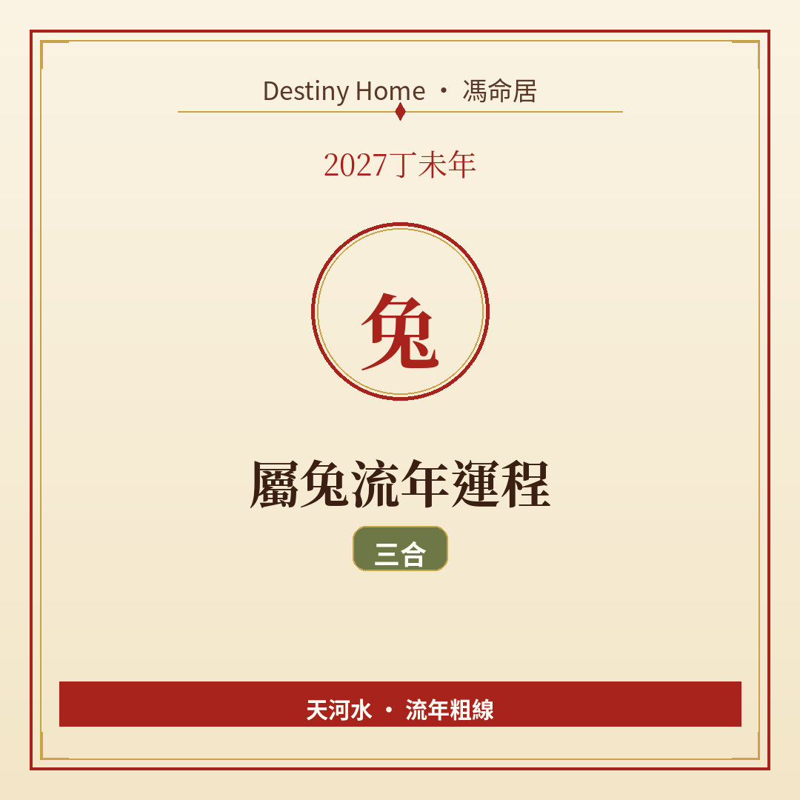

# 2027丁未年｜屬兔流年運程

Destiny Home／馮命居

屬兔今年走 **三合局（亥卯未）**——人脈、合作、機會較易湊埋一齊。關鍵字：**借力打力、揀對手、節奏要穩**。

## 出生年份提示

常見屬兔年份（國曆約數）：1951、1963、1975、1987、1999、2011、2023。  
立春前出世可能屬前肖（虎）。民間跟農曆年，八字跟立春。

## 整體運勢

丁未年納音「天河水」，水氣澄養木氣，合局更容易流動。三合唔係「躺贏」，而係 **門打開多咗**：有人介紹、有項目找上門、有機會同人一齊做事。丁未年未土當令，卯木得合，屬兔會覺得「世界對我冇咁硬」。

但合局亦會引來「好多選擇」——揀錯夥伴，一樣撰。今年修行係識得拒絕不合格嘅合。

## 事業／工作

適合聯乘、跨部門、客戶轉介、團隊項目。個人單打獨鬥未必差，但有人幫手往往快啲出成績。注意：

- 分工同分成早講清楚；
- 唔好因為人情就低價接單；
- 展現你細心同審美／協調強項，會好受用。

想轉工或接 side project，三合年較易遇到貴人牽線——仍然要核實對方往績。

## 財運

正財同合作收入有機會向上，但「齊齊賺錢」亦要齊齊對帳。共同投資、合夥開店要謹慎：合得來唔等於帳目自然清楚。

宜：分階段投入、保留獨立現金流、大額要律師／會計過目（視乎規模）。偏財唔好跟風，合局年最易被「朋友推介」帶節奏。

## 感情／人際

人緣明顯暖啲。單身者透過朋友聚會、興趣班識人機會增；有伴者適合見家長、旅行、商量未來計畫。要小心嘅係「過份遷就」——合局有時會令你唔好意思講唔。

職場上多幫手、少嚼舌，形象會加分。

## 健康／身心

肝膽、過敏、眼睛同肩頸（長期對住電腦）值得護理。社交多會晚睡，盡量唔好連續透支。情緒整體偏向樂觀，但亦要防「為人太多忘咖自己」。

## 今年提點／化解

1. **合作先寫清晰分工同退出機制**。  
2. **每個月留白日**——合局忙，要刻意休息。  
3. **貴人要識得報恩同回饋**，但唔好無底線付出。  
4. **機會多就篩選**，唔係逢請必應。

## 短結

屬兔 2027 合局在側，宜主動但不盲從。揀對人，一年可以好充實；揀錯人，就變成好人做到尾。

想睇得更準，記得生肖流年只係粗線，真正細位要對八字同大運。Destiny Home 有【流年詳批 HK$128】同【全批一生大運＋十年大運＋流年 HK$688】，歡迎到 https://destinyhomehk.com 了解，或者 WhatsApp 預約（destiny_home_）。

※ 本文僅供參考，非醫療、投資或法律建議。內容屬流年趨勢分享，亦可能運用 AI／非師傅親批之輔助整理，實際決策請以個人情況同專業意見為準。
