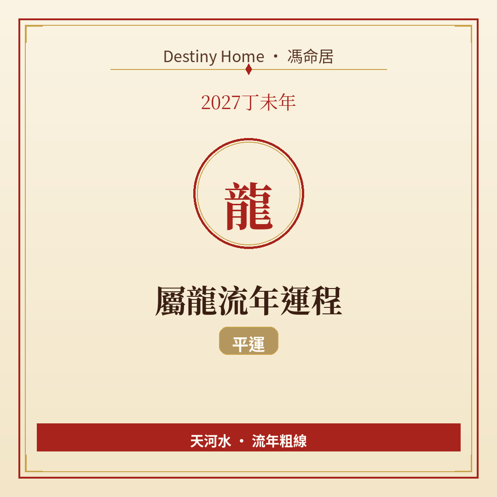

# 2027丁未年｜屬龍流年運程

Destiny Home／馮命居

屬龍今年 **無直接沖合刑害**，平運自求發揮。關鍵字：**收斂鋒芒、做實績、長線布局**。

## 出生年份提示

常見屬龍年份（國曆約數）：1952、1964、1976、1988、2000、2012、2024。  
立春前出世可能屬前肖（兔）。八字流年由立春起算。

## 整體運勢

屬龍平時氣場強、想事大。丁未年火土結構下，外界未必個個都跟你節奏——平運年反而考你「可唔可以沉住氣把一件事做到好」。納音天河水提醒：志向可以高，落地要濕潤細緻，唔好淨係乾燒。

比起追逐新刺激，今年更值得把已經開始嘅局收成。你哋唔缺靈感，缺嘅往往係「做到別人睇得見嘅成品」。

冇沖冇合唔代表冇戲，而係戲要自己寫劇本。

## 事業／工作

適合深耕專業、考牌／進修、把已有項目做到可展示成果。搶風頭可以，但今年「做得實」比「講得響」更有回報。

平運年冊太歲推一把，亦冊太歲拉住你——進度幾乎完全睇自制力。若行業有公開比賽、專業認證或內部標罵項目，值得挑一個全力完成。

管人或創業者：授權同檢查並重，唔好以為下屬自然明白你願景。打工族：用作品集同數據說話，升遷談判先準備案例。

## 財運

穩健累積為主。大格局投資要分階段，唔好一把過。屬龍有時為面子開支偏大——今年檢視「呢筆錢係需要定係排場」。

應酬可以有，但預先設上限，散場唔好再加單。現金流記清楚：收入進帳、固定開支、機會預算三條線分開，會令你嘅「大氣場」落地成數字。

副業若同專業相關，平運年慢慢養，後年先收成都唔遲。

## 感情／人際

你容易吸引仰慕者，亦容易顯得距離感。單身者主動同時要願意聽；有伴者注意「我話事」嘅語氣，多問對方感受。

朋友圈可以精簡，深交幾個勝過識一百個點頭之交。

## 健康／身心

心血管、血壓、頭痛同過度用腦要平衡。運動加靜態調節（伸展、呼吸練習）會幫到你。留意腰背——坐得耐同壓力大一齊來。

## 今年提點／化解

1. **揀一件事做到可交代成果**，勝過開十個半成品。  
2. **公開承諾前先內審資源**。  
3. **每週留家庭／自己時間**，防工作吞噬生活。  
4. **錢銀同面子分開計**。

## 短結

屬龍 2027 平運見真章：收得住、做得細，氣場先會轉化成實利。

想睇得更準，記得生肖流年只係粗線，真正細位要對八字同大運。Destiny Home 有【流年詳批 HK$128】同【全批一生大運＋十年大運＋流年 HK$688】，歡迎到 https://destinyhomehk.com 了解，或者 WhatsApp 預約（destiny_home_）。

※ 本文僅供參考，非醫療、投資或法律建議。內容屬流年趨勢分享，亦可能運用 AI／非師傅親批之輔助整理，實際決策請以個人情況同專業意見為準。
