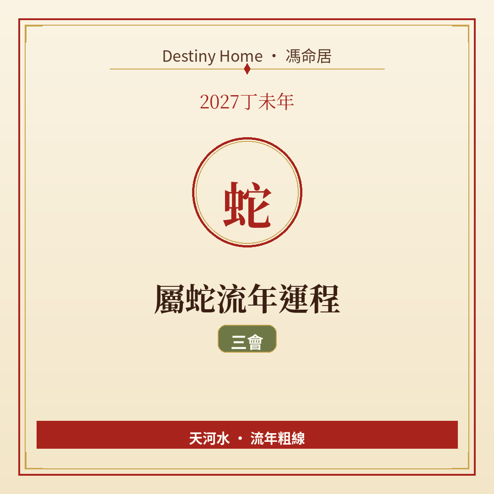

# 2027丁未年｜屬蛇流年運程

Destiny Home／馮命居

屬蛇今年得 **三會（巳午未）**——南方火局成形，事業同曝光度有機會加溫。關鍵字：**趁勢推進、曝光有度、防火過旺**。

## 出生年份提示

常見屬蛇年份（國曆約數）：1953、1965、1977、1989、2001、2013、2025。  
立春前出世可能屬前肖（龍）。八字跟立春，民間生肖多跟農曆正月初一。

## 整體運勢

巳午未三會，火勢集中。屬蛇本身巳火，今年容易覺得「有嘢發生緊」：項目加速、被人看見、想法較多。丁未再疊陰火同未土，熱情同壓力可以一齊上升。

三會係機遇局，亦係消耗局——燒得旺就要識得添水（休息、冷靜決策）。納音天河水正好提點你：熱中留一條退路。

## 事業／工作

適合發表、簡報、公開項目、市場擴張、轉職去更有能見度嘅角色。你哋擅長策略同觀察，今年可以把後台籌備搬去前台一點。

注意：火旺時容易口快、承諾過多。接 job 前問自己——時間同體力真係夠嗎？團隊合作要寫清楚交付日期。

## 財運

事業帶動正財機會不錯；廣告、佣金、表演／內容相關收入（視行業）或有亮點。但開支亦易因應酬同「投資形象」上升。

宜設「機會預算」：有好項目先用呢筆錢，唔好動用救命錢去追風口。投資忌聽氣氛追高。

## 感情／人際

魅力上升，單身較易被注意；亦要分清欣賞同合適。有伴者，工作忙唔好冷待伴侶——短訊一句關心都有用。

人際上防「又愛又妒」：你出風頭，旁人或有複雜情緒，低調炫耀、多帶人一齊好。

## 健康／身心

心血管、炎症、眼睛、皮膚同焦慮感要護理。減少連續熬夜同刺激性飲食。運動選能出汗但唔過度嘅項目，事後要補水同睡眠。

## 今年提點／化解

1. **機會分優先級**，頂多同時推兩件大事。  
2. **公開發言先打草稿**，防火旺口業。  
3. **每週固定休養生息**，當「加水」。  
4. **財務分開「日常」同「機會」帳戶**。

## 短結

屬蛇 2027 三會加持，宜進亦宜護心火。勢要用，命要惜。

想睇得更準，記得生肖流年只係粗線，真正細位要對八字同大運。Destiny Home 有【流年詳批 HK$128】同【全批一生大運＋十年大運＋流年 HK$688】，歡迎到 https://destinyhomehk.com 了解，或者 WhatsApp 預約（destiny_home_）。

※ 本文僅供參考，非醫療、投資或法律建議。內容屬流年趨勢分享，亦可能運用 AI／非師傅親批之輔助整理，實際決策請以個人情況同專業意見為準。
