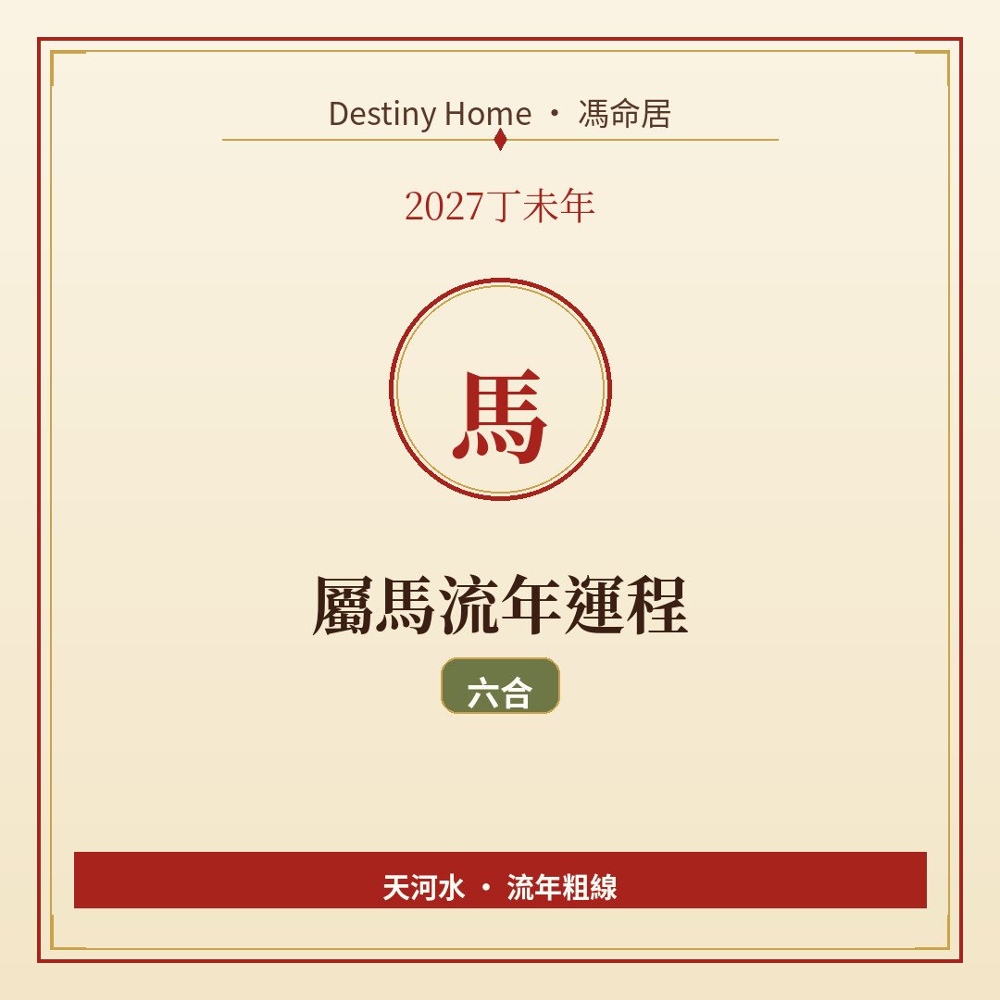

# 2027丁未年｜屬馬流年運程

Destiny Home／馮命居

屬馬今年 **六合（午未合）**——貴人、合夥、節奏相對順暢。關鍵字：**借合開路、誠信為本、唔好貪快**。

## 出生年份提示

常見屬馬年份（國曆約數）：1954、1966、1978、1990、2002、2014、2026。  
立春前出世可能屬前肖（蛇）。八字流年由 2027-02-04 約 09:46（香港時間）起算。

## 整體運勢

午未六合係十二生肖入面相對溫暖嘅組合——有人願意幫、有事較易談攏、心情亦容易樂觀啲。丁未年未土當令，馬嘅午火得合，像有人喺旁邊扶一把。

但合亦綁住責任：你答應得爽快，就要交貨；別人幫你，你都要識得回報同守約。納音天河水提醒：順嘅時候更要防漂——唔好因為順利就鬆懈細節。

## 事業／工作

合夥、內部調動去更合適崗位、客戶關係維繫，都係重點。適合主動約一個可以互相補位嘅同事或夥伴傾長期合作。

升遷同加薪談判，六合年氣氛較好講——準備業績清單，誠懇提出。轉工亦可以，但「人係唔係真合」比「錢多幾舊」更關鍵。

## 財運

正財同合作分帳機會增。共同投資前，務必講明出資、分工、退出。六合最怕「因為熟所以唔寫低」。

個人開支可以稍微獎勵自己，但仍要有預算。偏財唔好因為感覺好運就加倍下注——合係人緣，唔係賭運保證。

## 感情／人際

桃花同人和都不錯。單身者較易遇可深交對象；有伴者適合商量同居、結婚、家庭計畫等「合」嘅議題——前提係雙方自願，唔好被催。

朋友請託會增多，學會溫柔拒絕先保護到合嘅質素。

## 健康／身心

心臟、血壓、睡眠同腳傷（奔波）要留意。雖然心情較靚，都唔好透支身體去證明自己「好有用」。

## 今年提點／化解

1. **每個合作都留書面紀要**。  
2. **貴人幫忙要記低、要回報**，唔好當理所當然。  
3. **順境仍做最壞打算儲備**。  
4. **感情重大決定雙方時間對齊**，唔催唔拖。

## 短結

屬馬 2027 六合在旁，宜誠信借力。順唔代表可以飄，細位做好，合先長久。

想睇得更準，記得生肖流年只係粗線，真正細位要對八字同大運。Destiny Home 有【流年詳批 HK$128】同【全批一生大運＋十年大運＋流年 HK$688】，歡迎到 https://destinyhomehk.com 了解，或者 WhatsApp 預約（destiny_home_）。

※ 本文僅供參考，非醫療、投資或法律建議。內容屬流年趨勢分享，亦可能運用 AI／非師傅親批之輔助整理，實際決策請以個人情況同專業意見為準。
