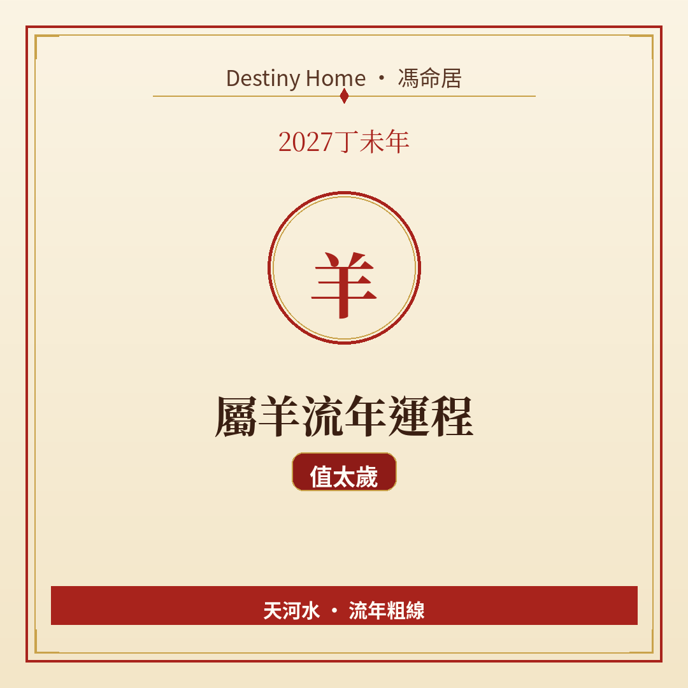

# 2027丁未年｜屬羊流年運程

Destiny Home／馮命居

屬羊今年 **值太歲（本命年）**——未年遇未，事多、被注視、節奏容易被打亂。關鍵字：**低調守成、減少承諾、身心優先**。

## 出生年份提示

常見屬羊年份（國曆約數）：1955、1967、1979、1991、2003、2015、**2027**。  
本命年生肖特別要核對立春邊界：八字流年由立春（2027-02-04 約 09:46 香港時間）起算；民間亦有跟農曆正月初一（2027-02-06）。立春前出世嘅「國曆 2027 寶寶」未必算入未年八字，但民間仍常當本命年處理——有疑問建議對八字。

## 整體運勢

丁未年納音「天河水」，提醒你在火土之中留一點澄靜。值太歲唔等於災難年，而係 **感光度提高**：小事都可能放大、身體同情緒較敏感、周圍人對你嘅要求亦多。丁火坐未，火土交雜，屬羊容易又想做好又易攰。

策略好簡單：**少承諾、多完成、少曝光、多休養**。想開新局可以，但規模細啲、驗收快啲。

## 事業／工作

宜守住本份、把進行中項目收斂完成，唔好同時開太多戰場。表現可以有，但唔好喺人多嘅場合硬碰硬爭功。

轉工、創業、公開競標——若非時機成熟同資源充足，寧願延後或縮小範圍。被調職或加工作量時，及時講自己負荷，唔好默默硬食。

## 財運

本命年經典提示係「破財消災」——其實好多時係突發開支、醫療、維修、人情。預留預算當「保護費」比死慳更實在。

投資宜保守；為人擔保、借大筆錢出去，風險偏高。買保險、補牙、修屋這類「必要開支」反而可以視作穩定生活嘅投資。

## 感情／人際

情緒起伏可能影響親密關係——你需要更多體諒，對方未必知。主動講：「我今年想慢啲、簡單啲。」單身者唔急於定終身；有伴者減少比較同猜疑。

社交活動揀質量，唔好為面子周不周到場。

## 健康／身心

脾胃、濕疹／皮膚、睡眠、情緒低落或焦慮都要監察。本命年最實際嘅「化解」往往係身體檢查同規律作息。運動溫和、飲食清淡、少酒精。

若感持續唔妥，求醫，唔好淨係靠玄學安慰。

## 今年提點／化解

1. **紅／本命年服飾屬民俗心意**，開心就好，唔迷信。  
2. **安太歲可作為傳統安心選項**，重點仍係生活管理。  
3. **大額、長約、聯名決定能拖就拖，或者請人審一審**。  
4. **每季做一次身心檢查清單**（睡眠、運動、朋友、工作負荷）。

## 短結

屬羊 2027 值太歲，宜厚養自己。守得住、睡得好、少攬事，就已經係上等運程。

想睇得更準，記得生肖流年只係粗線，真正細位要對八字同大運。Destiny Home 有【流年詳批 HK$128】同【全批一生大運＋十年大運＋流年 HK$688】，歡迎到 https://destinyhomehk.com 了解，或者 WhatsApp 預約（destiny_home_）。

※ 本文僅供參考，非醫療、投資或法律建議。內容屬流年趨勢分享，亦可能運用 AI／非師傅親批之輔助整理，實際決策請以個人情況同專業意見為準。
