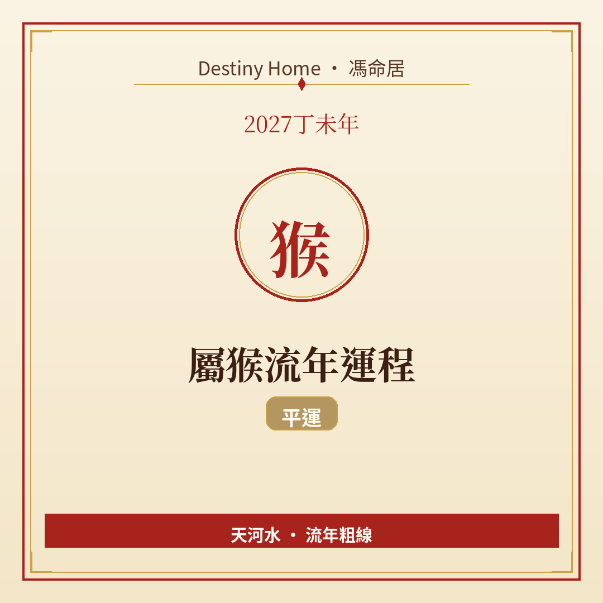

# 2027丁未年｜屬猴流年運程

Destiny Home／馮命居

屬猴今年 **無直接沖合刑害**，平運格局。關鍵字：**把聰明用喺長線、少耍小聰明、技能變現**。

## 出生年份提示

常見屬猴年份（國曆約數）：1956、1968、1980、1992、2004、2016。  
立春前出世可能屬前肖（羊）。八字流年由立春起算。

## 整體運勢

屬猴腦快手快，平運年最怕「樣樣都掂吓、樣樣唔精」。丁未年氣氛有熱度，你會見到好多題目好玩——紀律先係你今年嘅貴人。納音天河水：思緒可以流，但要有河道（目標同截止日期）。

與其等「感覺對咖先開始」，不如用小期限逼自己交貨；交得多，運氣反而會跟住嚅。

冇太歲沖合，自由度高，成績同努力成正比。

## 事業／工作

適合學新工具、考證、優化流程、接可以累積作品嘅項目。你哋擅長變通，今年把變通變成可複製嘅方法，先有議價力。

例如把你慣用嘅捷徑寫成 checklist，不單幫自己，仲可以成為團隊貢獻。若現職悶，唔好淨係吐槽——用三個月做出可帶走嘅成果再走，身價會不一樣。

職場上少講人是非、多交可見成果。轉工可以主動睇，面試講案例比講性格更有殺傷力。

## 財運

靠技能同效率賺錢比較穩；投機取巧、短炒消息，平運年未必罩你。檢視訂閱同「散錢」，積少成多。

屬猴手快，網購同 App 內購特別要設閘。收費標準寫清楚，避免「人情價」侵蝕利潤。年底可以為自己做一次簡單財務年結，睇邊樣真係賺、邊樣只係好玩。

若有副業，選一個養足半年，唔好三個月換題目。

## 感情／人際

幽默係你武器，但唔好用嚟逃遁認真對話。單身可以玩得開心，同時講清楚自己想點；有伴者，多承擔少甩鍋。

朋友聚會豐富，記得留時間畀家人。

## 健康／身心

神經系統、睡眠、肩頸同腸胃（飲食不規律）要管。手機同加班係隱形消耗，定「斷網時段」。

## 今年提點／化解

1. **全年最多推兩個主項目**。  
2. **每學一項新技能，就設一個變現期限**。  
3. **金錢自動化：儲蓄先轉帳再使**。  
4. **重要對話唔好只用玩笑帶過**。

## 短結

屬猴 2027 平運見功夫：收斂分心，聰明先變真金白銀。

想睇得更準，記得生肖流年只係粗線，真正細位要對八字同大運。Destiny Home 有【流年詳批 HK$128】同【全批一生大運＋十年大運＋流年 HK$688】，歡迎到 https://destinyhomehk.com 了解，或者 WhatsApp 預約（destiny_home_）。

※ 本文僅供參考，非醫療、投資或法律建議。內容屬流年趨勢分享，亦可能運用 AI／非師傅親批之輔助整理，實際決策請以個人情況同專業意見為準。
