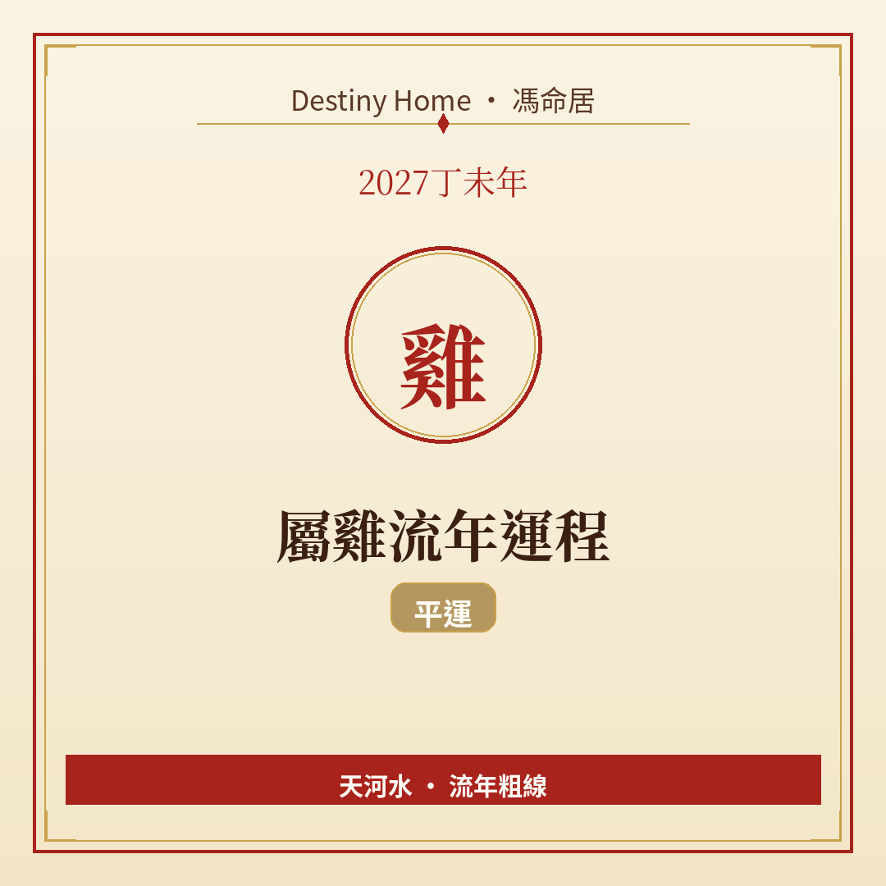

# 2027丁未年｜屬雞流年運程

Destiny Home／馮命居

屬雞今年 **無直接沖合刑害**，平運自求發揮。關鍵字：**細節致勝、形象管理、穩中求進**。

## 出生年份提示

常見屬雞年份（國曆約數）：1957、1969、1981、1993、2005、2017。  
立春前出世可能屬前肖（猴）。八字流年由 2027-02-04 約 09:46（香港時間）起算。

## 整體運勢

屬雞重視秩序同體面。丁未年火土同見，外界節奏未必咁整齊——你容易因為「啲人點解咁亂」而煩。平運年教你：控制自己流程，唔好試圖控制全世界。

平運年教你把注意力放喺可控範圍：流程、交貨同語氣。外界再亂，你都守得住自己一畝田，已經係競爭力。

納音天河水：俾少少彈性自己，反而走得遠。

## 事業／工作

文書、品質控管、客戶服務、教學、設計執行等講細節嘅崗位，今年容易被看見。適合整理 SOP、優化報表、把混亂項目救返嚅。

升遷靠可靠度；轉工帶作品同推薦信。避免喺公開場合尖銳批評同事——你準，但今年「準」要包裝成「建議」。

## 財運

正財穩，理財適合定期檢視資產配置。聽落好吸引嘅「保證回報」要加倍懷疑。大額消費可以為提升專業形象（課程、設備），但要有上限。

記帳對屬雞嚟講係天賦，今年用返呢個天賦就得。

## 感情／人際

你要求高，伴侶同朋友有時覺得壓力大。單身者放寬「必須完美」清單一格；有伴者多讚賞少挑錯。

職場人際保持禮貌距離，專業形象係你護城河。

## 健康／身心

呼吸道、皮膚、睡眠質素同過度清潔／焦慮要平衡。運動加戶外時間，幫你從細節焦慮抽離。

## 今年提點／化解

1. **每週只優化一個流程**，唔好全面開戰。  
2. **批評改為「觀察＋建議＋幫助」三步**。  
3. **財務季度檢討一次即可**，唔使日日盯盤。  
4. **安排無目的休閒**，練習放空。

## 短結

屬雞 2027 平運宜以細節換信任。穩、準、有溫度，就係你今年最強配置。

想睇得更準，記得生肖流年只係粗線，真正細位要對八字同大運。Destiny Home 有【流年詳批 HK$128】同【全批一生大運＋十年大運＋流年 HK$688】，歡迎到 https://destinyhomehk.com 了解，或者 WhatsApp 預約（destiny_home_）。

※ 本文僅供參考，非醫療、投資或法律建議。內容屬流年趨勢分享，亦可能運用 AI／非師傅親批之輔助整理，實際決策請以個人情況同專業意見為準。
