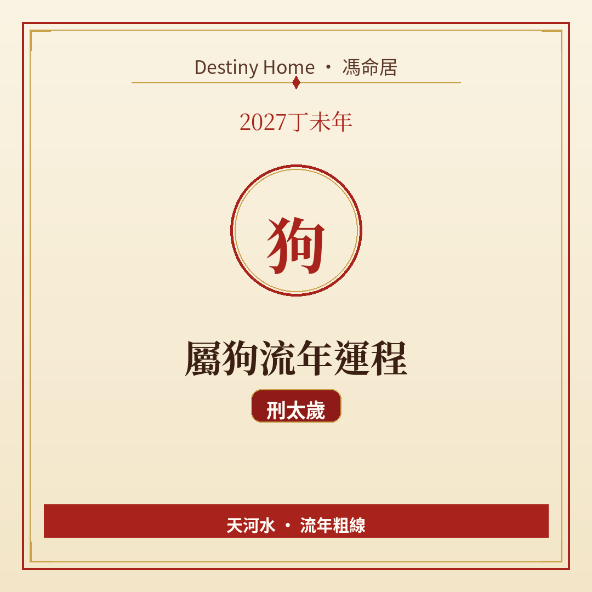

# 2027丁未年｜屬狗流年運程

Destiny Home／馮命居

屬狗今年 **刑太歲（戌未刑）**，兼有破嘅意味（輕提）——是非、細節出錯、計畫被打亂較常見。關鍵字：**防是非、查細節、節奏留緩衝**。

## 出生年份提示

常見屬狗年份（國曆約數）：1958、1970、1982、1994、2006、2018。  
立春前出世可能屬前肖（雞）。犯太歲年份建議同時核對八字；民間生肖多跟農曆年，八字跟立春（2027-02-04 約 09:46 香港時間）。

## 整體運勢

戌未刑同「秩序被擾」有關：文件出錯、行程撞期、規則突然改、身邊有人挑剔或傳話。破嘅味道係「合唔攏、易散」——合作可以有，但要預留散伙或者重談嘅空間。

丁未年火土重、納音天河水，屬狗義氣深，容易為人出頭而惹事。本年宜：**護自己先，先至有力護人**。

## 事業／工作

檢查、合規、交付質素係關鍵。你覺得「差唔多得」嘅位，今年偏偏易出事。建議：

- 重要電郵延遲五分鐘再Send，重讀一次；
- 項目留 10–20% 時間緩衝；
- 是非圈速離，唔做傳聲筒。

轉工或內部鬥爭中，書面記錄你嘅貢獻同指示，防口講無憑。

## 財運

因疏忽產生嘅罰款、損失、重做成本要防。合約細則、自動續期、保險條款睇清楚。投資忌聽信「內部消息」——刑年資訊真假更亂。

正財仍然可靠；大額聯名要謹慎。

## 感情／人際

忠誠嘅你，最怕被辜負或者誤會。刑太歲下，猜疑同「你點解唔同我講」會增多——用澄清取代想像。家人朋友嘅錢銀往來，今年能免則免。

拍拖吵架就事論事，唔好翻舊帳翻三年。

## 健康／身心

消化、皮膚過敏、筋骨扭傷、精神緊張。運動注意熱身；工作注意工傷同姿勢。情緒上，寫下來比悶喺心好。

## 今年提點／化解

1. **雙重核對習慣**——密碼、帳戶、合約、藥單。  
2. **是非面前裝忙**——唔回應就係上策。  
3. **行程同備份預留空檔**。  
4. **安太歲屬民俗選項**；實際化解係細節管理同人際界線。

## 短結

屬狗 2027 刑破輕擾，事在「防微杜漸」。你守得住細節同良心，風波多數係陣間嘅事。

想睇得更準，記得生肖流年只係粗線，真正細位要對八字同大運。Destiny Home 有【流年詳批 HK$128】同【全批一生大運＋十年大運＋流年 HK$688】，歡迎到 https://destinyhomehk.com 了解，或者 WhatsApp 預約（destiny_home_）。

※ 本文僅供參考，非醫療、投資或法律建議。內容屬流年趨勢分享，亦可能運用 AI／非師傅親批之輔助整理，實際決策請以個人情況同專業意見為準。
