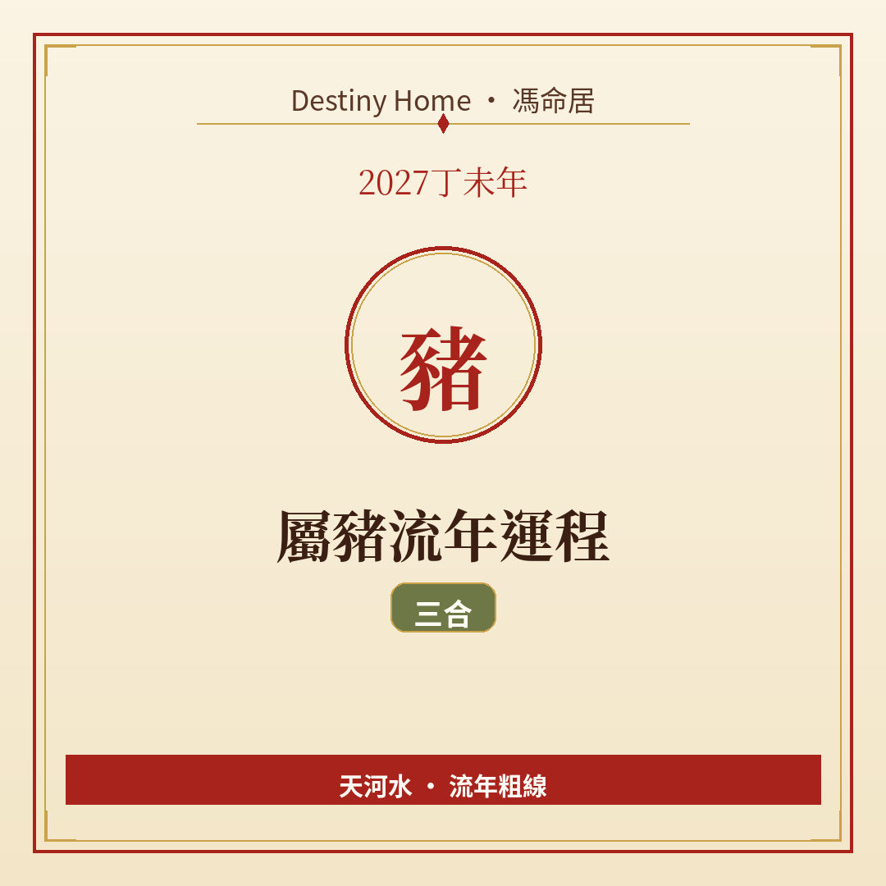

# 2027丁未年｜屬豬流年運程

Destiny Home／馮命居

屬豬今年走 **三合局（亥卯未）**——支援、人緣、項目較易開花。關鍵字：**承接善意、務實落地、享福唔忘節制**。

## 出生年份提示

常見屬豬年份（國曆約數）：1959、1971、1983、1995、2007、2019。  
立春前出世可能屬前肖（狗）。八字流年由立春起算；民間多跟農曆正月初一。

## 整體運勢

亥卯未三合，屬豬得木局疏通，像有人在旁邊澆水施肥——機會同幫助來得自然啲。丁未年未土當令，合局令你唔使硬碰都可以有進度。

要小心嘅係「舒服到唔想郁」：合局年最易享受當下而拖延長線目標。納音天河水：水流得暢，記得裝桶（儲蓄同技能）。

## 事業／工作

適合承接引薦、客戶關係、創意同服務類工作。團隊入面你做「令大家舒服同埋得埋」嗰個，價值好高——記得把貢獻講出來，唔好默默做完無人知。

升遷、轉職、學習新領域都有空間；選能發揮你誠懇同耐力嘅環境。

## 財運

人緣帶財機會在，但「請人客、撐場面」開支亦會跟住上。設享樂預算，超過就停。合作生意要講明錢銀，唔好因為大家開心就唔好意思問。

儲蓄同投資以穩為主，三合年適合養一個長線習慣（例如每月定投——注意係習慣，唔係保證賺）。

## 感情／人際

人緣暖，桃花同朋友運都不錯。單身者容易遇溫柔類型；有伴者適合一起旅行、改善家居、商量生活品質。

界線仍然要有：好人唔等於有求必應。對反复消耗你嘅人，今年適合慢慢抽離。

## 健康／身心

消化系統、體重、水腫同睡眠。飲食豐富唔緊要，份量同規律更重要。適量運動（游水、散步、瑜伽）好襯你節奏。

## 今年提點／化解

1. **受人恩惠要記、要回**，關係先長久。  
2. **享樂同儲蓄分開戶口**。  
3. **把口頭好意變成實際日程**——合局怕流於氣氛。  
4. **對消耗型關係溫柔抽離**。

## 短結

屬豬 2027 三合相伴，宜感恩亦宜進取。接得住緣分、守得住節制，一年可以又暖又實。

想睇得更準，記得生肖流年只係粗線，真正細位要對八字同大運。Destiny Home 有【流年詳批 HK$128】同【全批一生大運＋十年大運＋流年 HK$688】，歡迎到 https://destinyhomehk.com 了解，或者 WhatsApp 預約（destiny_home_）。

※ 本文僅供參考，非醫療、投資或法律建議。內容屬流年趨勢分享，亦可能運用 AI／非師傅親批之輔助整理，實際決策請以個人情況同專業意見為準。
